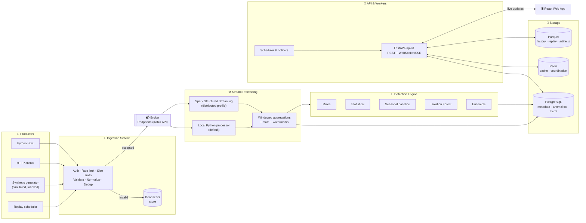
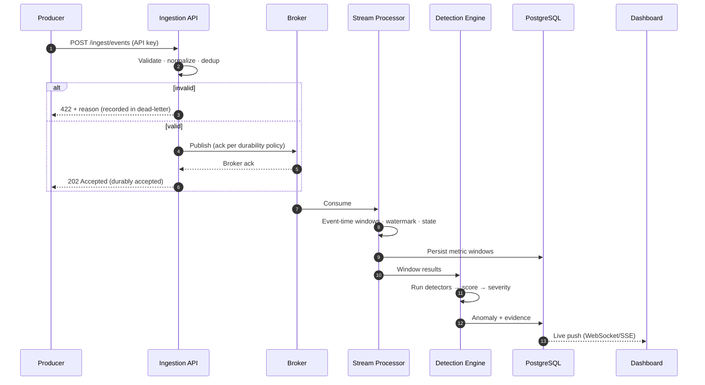
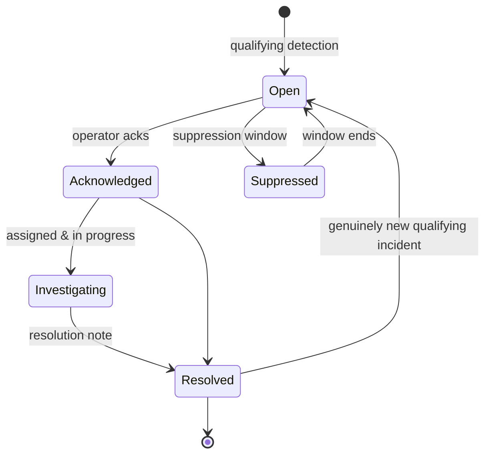
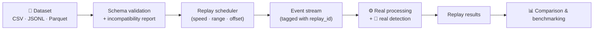
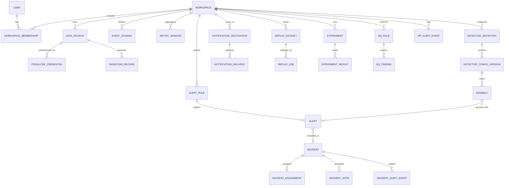

<div align="center">

```
██╗   ██╗███████╗██╗   ██╗██╗      ███████╗████████╗██████╗ ███████╗ █████╗ ███╗   ███╗
██║   ██║██╔════╝╚██╗ ██╔╝██║      ██╔════╝╚══██╔══╝██╔══██╗██╔════╝██╔══██╗████╗ ████║
██║   ██║█████╗   ╚████╔╝ ██║      ███████╗   ██║   ██████╔╝█████╗  ███████║██╔████╔██║
╚██╗ ██╔╝██╔══╝    ╚██╔╝  ██║      ╚════██║   ██║   ██╔══██╗██╔══╝  ██╔══██║██║╚██╔╝██║
 ╚████╔╝ ███████╗   ██║   ███████╗ ███████║   ██║   ██║  ██║███████╗██║  ██║██║ ╚═╝ ██║
  ╚═══╝  ╚══════╝   ╚═╝   ╚══════╝ ╚══════╝   ╚═╝   ╚═╝  ╚═╝╚══════╝╚═╝  ╚═╝╚═╝     ╚═╝
```

### *See the signal. Detect the unexpected.*

**A real-time intelligence and anomaly detection platform that ingests continuous event streams, computes windowed analytics, detects abnormal behavior with multiple methods, manages incidents, monitors pipeline health, replays history, and benchmarks detectors, all in one cohesive product.**

<br/>


[Overview](#-overview) · [Features](#-feature-overview) · [Architecture](#-architecture) · [Detection](#-anomaly-detection-engine) · [Quick Start](#-quick-start) · [Demo](#-guided-demo-walkthrough) · [Research Lab](#-research--experiment-laboratory) · [Testing](#-testing) · [Docs](#-documentation) · [Limitations](#-production-readiness--known-limitations)

</div>

---

## 📖 Table of Contents

1. [Overview](#-overview)
2. [Use Cases](#-primary-use-cases)
3. [Feature Overview](#-feature-overview)
4. [Architecture](#-architecture)
5. [Technology Stack](#-technology-stack)
6. [Event Lifecycle & Data Contracts](#-event-lifecycle--data-contracts)
7. [Ingestion & Producer SDK](#-ingestion--producer-sdk)
8. [Stream Processing Engine](#-stream-processing-engine)
9. [Anomaly Detection Engine](#-anomaly-detection-engine)
10. [Alerts & Incident Management](#-alerts--incident-management)
11. [Data Quality & Pipeline Observability](#-data-quality--pipeline-observability)
12. [Historical Replay](#-historical-replay)
13. [Synthetic Data Generator](#-synthetic-data-generator)
14. [Research & Experiment Laboratory](#-research--experiment-laboratory)
15. [Frontend Experience](#-frontend-experience)
16. [Database Design](#-database-design)
17. [REST & Live API](#-rest--live-api)
18. [Security & Access Control](#-security--access-control)
19. [Performance & Scalability](#-performance--scalability)
20. [Observability of Veylstream Itself](#-observability-of-veylstream-itself)
21. [Quick Start](#-quick-start)
22. [Guided Demo Walkthrough](#-guided-demo-walkthrough)
23. [Configuration](#-configuration)
24. [Testing](#-testing)
25. [CI/CD & Code Quality](#-cicd--code-quality)
26. [Repository Structure](#-repository-structure)
27. [Documentation](#-documentation)
28. [Production Readiness & Known Limitations](#-production-readiness--known-limitations)
29. [Roadmap](#-roadmap)
30. [Contributing](#-contributing)
31. [License](#-license)

---

## 🔭 Overview

Veylstream is a **distributed-capable streaming analytics platform with a lightweight local mode**. It helps engineering teams observe continuous event streams, understand operational behavior, catch abnormal patterns early, investigate incidents, keep their own data pipelines healthy, and *measure* how well different anomaly detection methods actually work.

It is built around **five integrated capabilities**:

| # | Capability | What it delivers |
|:-:|---|---|
| 1 | ⚡ **Real-time ingestion & processing** | Validated, durable event intake via HTTP and a Python SDK, flowing through a broker into a stream processor |
| 2 | 📊 **Streaming analytics & aggregations** | Tumbling and sliding event-time windows, group-by dimensions, percentiles, throughput, failure rates |
| 3 | 🚨 **Multi-method anomaly detection** | Rule-based, statistical, seasonal-baseline, ML (Isolation Forest), and ensemble detectors with explainable output |
| 4 | 🩺 **Pipeline observability & data quality** | Health of the platform itself: lag, rejected/late/duplicate events, dead letters, heartbeats, rule-based quality checks |
| 5 | 🧪 **Benchmarking & historical replay** | Replay past incidents through the real pipeline and compare detectors with precision / recall / F1 / detection delay |

> **One product, not five demos.** Simulated data flows through the *same* ingestion, processing, and detection pipeline used for any other source. There are no hardcoded KPIs, fake alerts, or decorative charts.

```text
                          ┌─────────────────────────────────────────────────────────┐
  Producers ─► Ingestion ─►  Validate/Normalize ─► Broker ─► Stream Processor        │
  (SDK/HTTP)    API              │                  (Redpanda)   │                   │
                                 ▼                               ▼                   │
                           Dead-letter Q              Windowed Aggregations          │
                                                                 │                   │
                                                                 ▼                   │
                           Alerts & Incidents ◄──── Detection Engine ◄── Baselines   │
                                 │                                                   │
                                 ▼                                                   │
                       Live Dashboard · Webhooks · Email · In-app notifications      │
                          └─────────────────────────────────────────────────────────┘
                 Historical dataset ─► Replay scheduler ─► (same pipeline) ─► Benchmarks
```

---

## 🎯 Primary Use Cases

| Scenario | How Veylstream helps |
|---|---|
| 💳 **Failed payments spike in one region** | Windowed failure-rate rule + statistical deviation flags the region/service, with evidence and sample size |
| 🐢 **Payment latency suddenly rises** | Percentile latency tracking and rolling-baseline detection catch degradation early |
| 📉 **Request volume drops below baseline** | Sudden-decrease and seasonal-baseline detectors surface silent failures |
| 🌡 **Sensor / application emits unusual measurements** | Z-score, MAD, IQR, and Isolation Forest highlight outliers |
| 🔇 **A producer stops sending records** | Heartbeat monitoring raises a producer-inactivity finding |
| 🧱 **Late, malformed, duplicate, or schema-drifted events** | Data-quality rules and dead-letter handling expose pipeline health issues |
| 🚦 **Traffic spike overwhelms a downstream service** | Throughput-spike detection plus queue/backpressure metrics |
| ⏪ **A past incident needs analysis** | Replay it through the real pipeline and compare detector configurations |

The demo domains are **e-commerce transactions** and **application telemetry**. The event model is deliberately extensible to other domains.

---

## ✨ Feature Overview

<table>
<tr>
<td width="50%" valign="top">

### ⚡ Streaming Core
- HTTP single/batch ingestion + heartbeat
- Python **producer SDK** with retry, backoff + jitter
- Kafka-compatible broker (**Redpanda**)
- **Local lightweight processor** *and* **Spark Structured Streaming**
- Tumbling & sliding **event-time windows**
- Watermarks, late-event policy, dedup, idempotency
- Dead-letter handling with failure reasons

### 🚨 Detection
- Rule-based (warning/critical, min-sample guards)
- Z-score, robust MAD, IQR, rolling baseline, sudden-shift
- Seasonal-baseline interface
- **Isolation Forest** with chronological evaluation
- Transparent **ensemble** strategies
- Per-anomaly explainability and deterministic investigation steps

</td>
<td width="50%" valign="top">

### 🧭 Operations
- Alert lifecycle: open → acknowledged → investigating → resolved / suppressed
- Grouping, dedup, cooldown, suppression windows
- Incidents with timeline, assignment, notes, audit history
- Webhook (bounded retries + delivery logs), optional SMTP, in-app
- **Pipeline health** from real component checks
- Data-quality rule engine

### 🧪 Research & Replay
- Import **CSV / JSONL / Parquet** datasets
- Replay with speed, pause/resume, seek, rejected-row view
- Reproducible **experiments** with ground-truth metrics
- Precision / recall / F1 / FPR / detection delay / confusion matrix
- Side-by-side comparison, CSV/JSON export, research summary
- Deterministic seeded synthetic scenarios

</td>
</tr>
</table>

---

## 🏗 Architecture

Veylstream is a **modular monorepo** with clear boundaries between the web app, API, ingestion, streaming workers, detection engine, infrastructure, and experiments, with **two runtime profiles**.



### Two runtime profiles

| | 🟢 **Local profile** (default) | 🔵 **Distributed profile** (optional) |
|---|---|---|
| **Compose file** | `docker-compose.yml` | `docker-compose.distributed.yml` |
| **Processor** | Lightweight Python processor | Spark Structured Streaming |
| **Broker** | Redpanda (single node) | Redpanda with partitioned topics, consumer concurrency |
| **Goal** | Runs on a laptop, full feature coverage | Demonstrates horizontal scale patterns |
| **Guarantees** | Real ingestion, windows, detection, persistence, live UI. **No distributed guarantees implied** | Partitioned processing, consumer lag metrics |
| **Event contracts / aggregation semantics** | ✅ Same | ✅ Same |

> The UI **always shows the active processing mode**. Local mode never pretends to offer distributed capacity, and a **processor adapter** interface lets either engine be swapped without touching the product.

### Event lifecycle



> **Durability policy:** an event is only reported as *accepted* after the documented broker acknowledgement. It is never acknowledged when it merely sits in an in-memory buffer that could vanish on process termination.

---

## 🧰 Technology Stack

| Layer | Technology | Role |
|---|---|---|
| **Web** | React · TypeScript (strict) · Vite | SPA with type-safe components |
| **Styling / UI** | Tailwind CSS · shadcn/ui | Dark-first design-token system, accessible components |
| **Data fetching** | TanStack Query · React Router | Cache management and routing |
| **Charts** | Apache ECharts | Time series, heatmaps, distributions, anomaly overlays |
| **Live updates** | WebSocket / Server-Sent Events | Real-time dashboard, with reconnect + keepalive |
| **API** | Python 3.12 · FastAPI · Pydantic | REST + live streaming endpoints, validated models |
| **ORM / migrations** | SQLAlchemy 2.x · Alembic | Relational persistence, versioned migrations |
| **Broker** | Redpanda (Kafka-compatible) | Durable event log |
| **Stream engines** | Python processor · Spark Structured Streaming | Local and distributed processing |
| **ML** | scikit-learn (Isolation Forest), isolated dependency group | Optional, so the core runs without heavy installs |
| **Storage** | PostgreSQL · Redis · Parquet · local FS (S3-compatible optional) | Metadata, cache, history, artifacts |
| **Metrics** | Prometheus-compatible endpoint · optional Grafana | Platform self-observability |
| **Quality** | Ruff · mypy · pytest · Vitest · Playwright | Lint, types, tests, E2E |
| **Delivery** | Docker · Docker Compose · GitHub Actions · Makefile | Reproducible environments and CI |

> No paid APIs, proprietary cloud services, or mandatory API keys are required.

---

## 📐 Event Lifecycle & Data Contracts

Versioned, validated schemas live in `packages/event-contracts/`. All timestamps are **UTC internally**. Event-time and processing-time are kept distinct.

### Normalized event envelope

| Field | Description |
|---|---|
| `event_id` | Unique identifier (idempotency / dedup key) |
| `schema_version` | Contract version, validated on ingest |
| `event_type` | e.g. `transaction`, `telemetry`, `heartbeat` |
| `event_timestamp` | When it happened (**event time**, UTC) |
| `ingestion_timestamp` | When Veylstream accepted it (UTC) |
| `source_id` · `source_type` | Producer identity |
| `environment` · `service_name` · `region` · `entity_id` | Dimensions |
| `trace_id` · `correlation_id` | Optional tracing links |
| measurements | Numeric values (latency, amount, CPU, memory, ...) |
| attributes | Structured dimensions |
| payload metadata | Optional |

### Domain event models

<details>
<summary><b>💳 Transaction events</b></summary>

`transaction_id` · `amount` · `currency` · `status` · `payment_method_category` · `region` · `service/processor` · `latency` · `failure_reason` · `timestamp`

</details>

<details>
<summary><b>📈 Application telemetry</b></summary>

request count or per-request events · response latency · HTTP status · service name · endpoint category · region · CPU / memory (when supplied) · timestamp

</details>

<details>
<summary><b>🧪 Data-quality events</b></summary>

producer heartbeat · validation failure · missing required field · duplicate event · late-arriving event · schema mismatch · producer inactivity

</details>

### Event correctness guarantees

- ✅ Required-field, schema-version, and timestamp validation
- ✅ Configurable **duplicate detection** and idempotent handling
- ✅ Explicit **late-event policy** and watermark behavior
- ✅ Safe handling of **unknown fields**
- ✅ **Dead-letter handling**: malformed records are *never silently dropped*. Reasons are recorded and rejected-event metrics are exposed

---

## 📥 Ingestion & Producer SDK

### HTTP ingestion

| Endpoint | Purpose |
|---|---|
| `POST /api/v1/ingest/events` | Single event |
| `POST /api/v1/ingest/events/batch` | Batch (size-limited) |
| `POST /api/v1/ingest/heartbeat` | Producer heartbeat |
| `GET  /api/v1/schemas` | Contract inspection |

**Protections:** API-key auth for machine producers (hashed at rest) · batch and payload size limits · per-source rate limits · duplicate detection · request correlation IDs · clear HTTP errors · ingestion metrics. A **development-only** synthetic generator exists, and the production ingestion endpoint is never left unrestricted.

### Producer SDK (Python)

```python
from veylstream import VeylstreamClient, TransactionEvent

client = VeylstreamClient(
    endpoint="http://localhost:8000",
    api_key="<your-producer-key>",   # from Data Sources → Create credential
    timeout=5.0,
    max_retries=5,                   # exponential backoff + jitter, transient errors only
)

event = TransactionEvent(
    transaction_id="txn_10492",
    amount=129.90,
    currency="USD",
    status="failed",
    payment_method_category="card",
    region="eu-west",
    service="payments-gateway",
    latency_ms=840,
    failure_reason="issuer_declined",
)

result = client.send(event)
print(result.status)          # accepted | rejected | retried | failed
print(result.error)           # useful message on failure

# Batch delivery with per-event results
results = client.send_batch([event, ...])
```

**SDK behavior:** creates valid events · single + batch sends · retries **transient** failures with exponential backoff and jitter · **never blindly retries permanent validation errors** · respects timeouts · returns explicit delivery results (**accepted / rejected / retried / failed**).

---

## ⚙️ Stream Processing Engine

A genuine processing subsystem. It is **not** a mocked pipeline.

### Windowed analytics

| Capability | Details |
|---|---|
| **Window types** | Tumbling · Sliding · Event-time · Processing-time monitoring |
| **Late data** | Configurable watermark and late-event policy, with late counts reported |
| **Grouping** | By service, region, event type, and other dimensions |
| **State** | Rolling baselines, window state, deduplication, detector state, all **bounded by retention/expiry** |
| **Restart behavior** | Defined per mode, with tests for processor restarts |

### Computed metrics

`total events` · `events/sec` · `successful vs. failed transactions` · `failure rate` · `avg / median / percentile / min / max latency` · `throughput by service & region` · `error counts` · `unique entities` · `late-event count` · `rejected-event count` · `duplicate-event count`

> **Percentiles:** the exact-vs-approximate method used for each calculation is documented in [`docs/architecture/`](./docs/architecture/), so no hidden approximation is passed off as exact.

### Aggregation correctness (tested)

Out-of-order events · duplicate events · empty windows · late records · processor restarts · business aggregates never double-count an event when the idempotency policy forbids it.

---

## 🧠 Anomaly Detection Engine

All detectors implement **one common interface**, and the **detector's decision is separate from the alerting policy**.

### Unified detection result

```jsonc
{
  "detector": { "name": "robust_mad", "version": "1.2.0" },
  "metric": "payment_failure_rate",
  "entity": { "service": "payments-gateway", "region": "eu-west" },
  "window": { "start": "2025-01-01T10:00:00Z", "end": "2025-01-01T10:01:00Z" },
  "observed": 0.31,
  "expected": 0.04,
  "expected_range": [0.01, 0.08],
  "score": 7.4,
  "severity": "high",
  "explanation": "Failure rate is 7.4 MADs above rolling baseline",
  "supporting": { "sample_size": 412, "baseline_window": "60m" },
  "config": { "...": "..." },
  "evidence_ref": "baseline://...",
  "dedup_key": "robust_mad:payment_failure_rate:payments-gateway:eu-west:..."
}
```

### Detector catalog

| Family | Detector | What it catches | Configurable |
|---|---|---|---|
| 📏 **Rule-based** | Failure-rate threshold · latency threshold · sudden throughput increase/decrease · missing heartbeat · data-quality error increase · service/region thresholds | Known bad conditions | Warning/critical levels, **min event count** |
| 📉 **Statistical** | Rolling mean + std · Z-score · robust median/**MAD** · **IQR** · rolling-baseline deviation · rate-of-change / sudden shift | Deviations from learned behavior | Baseline window, warm-up, sensitivity, min samples |
| 🔁 **Seasonal baseline** | Comparable prior-period baseline | Time-dependent patterns | Extensible interface. **Only claims seasonality it actually models** |
| 🌲 **Machine learning** | **Isolation Forest** with a feature-preparation pipeline | Multivariate unusual behavior | Contamination, features, training range. Records model version, features, dataset ref, training time, params |
| 🗳 **Ensemble** | Rule agreement · weighted scores · severity votes · min-detectors-agree | Reduces single-detector noise | Strategy is transparent, and scores are **normalized before combining** |

**Robustness:** zero variance, missing data, empty windows, and insufficient history are all handled without crashes. ML evaluation uses **chronological splits**, with no training on the future and testing on the past.

### Severity policy

| Level | Meaning |
|---|---|
| ⚪ Informational | Notable but not actionable |
| 🟢 Low | Minor deviation |
| 🟡 Medium | Meaningful deviation, review soon |
| 🟠 High | Significant impact likely |
| 🔴 Critical | Immediate attention |

> **Severity is not statistical confidence.** Every anomaly shows its evidence (sample size, baseline context) so users can judge it.

### Explainability (per anomaly)

*What changed* · *which metric* · *when it began* · *observed vs. expected range* · *magnitude & direction* · *which detector* · *supporting event volume* · *related service/region/entity* · *recent history* · *deterministic investigation steps*.

> Veylstream **does not fabricate causal explanations.** Correlation is not presented as causation.

---

## 🚨 Alerts & Incident Management



| Capability | Details |
|---|---|
| **Creation & dedup** | Alerts come from qualifying detections. **Grouping and dedup** stop one alert per event during a sustained incident |
| **Policies** | Configurable thresholds, routing rules, **cooldowns**, **suppression windows** |
| **Workflow** | Assignment, acknowledgement, resolution notes, **incident timeline**, related-anomaly links |
| **Audit** | Every status change recorded in an audit history |
| **Reopening** | Only when a genuinely new qualifying incident occurs |
| **Filtering** | Severity, status, search, bulk actions where safe |

### Notification channels

| Channel | Behavior |
|---|---|
| 🔔 **In-app** | Notification center with unread state |
| 🪝 **Webhook** | **Bounded retries, timeouts, delivery logs**, and safe destination validation |
| ✉️ **Email (optional)** | Configurable **SMTP**, never required for local dev |
| 🧪 **Test notification** | Sends a real test and shows the **actual result** |

---

## 🩺 Data Quality & Pipeline Observability

A dedicated area monitors the health of Veylstream **itself**, using real component checks rather than hardcoded "online" badges.

**Monitored:** ingestion throughput · accepted / rejected events · validation failures · duplicates · late events · **producer heartbeat delays** · broker availability · **consumer lag** · processor status · processing latency · **queue/buffer saturation** · failed processing attempts · **dead-letter volume** · database connectivity · API health · worker health.

### Data-quality rule engine

| Rule | Example |
|---|---|
| Required-field completeness | `region` present in ≥ 99% of events |
| Allowed values | `status ∈ {success, failed, pending}` |
| Numeric range | `latency_ms` between 0 and 60,000 |
| Uniqueness | `event_id` unique within retention |
| Freshness | Source emitted an event in last 5 minutes |
| Expected volume | Events per window within expected band |
| Schema consistency | Fields match the registered contract |
| Missing-field surge | Sudden rise in null fields |

Each rule has **scope/owner, enabled state, severity, and human-readable failure details**.

---

## ⏪ Historical Replay



| Control | Supported |
|---|:---:|
| Select dataset & time range | ✅ |
| Choose replay speed | ✅ |
| Pause / resume / stop | ✅ |
| Replay from offset or timestamp | ✅ where supported |
| Progress inspection & rejected-row view | ✅ |
| Persisted configuration and results | ✅ |

**Comparisons:** original vs. replayed timeline · detector configurations · anomaly counts & timing · **detection delay** · **false positives / missed anomalies** (when ground truth exists).

> Replayed records carry **replay IDs and provenance metadata**, so evaluation results are never mixed with live data.

---

## 🎲 Synthetic Data Generator

A deterministic, seeded generator produces realistic e-commerce streams. **All synthetic data is labelled as simulated in the UI.**

| Behavior | Scenarios |
|---|---|
| **Baseline traffic** | Time-of-day volume, multiple regions & services, latency distributions, random noise, payment successes/failures |
| **Anomaly scenarios** | Gradual drift · sudden spike · sudden drop · elevated failure rate · latency degradation |
| **Data problems** | Missing events · duplicates · late events · invalid payloads |
| **Infrastructure** | Producer outage |

- 🔁 **Deterministic seeds** for reproducible demos and experiments
- 🎛 Trigger any scenario deliberately from the UI or CLI
- 🛑 No unlimited background producers by default (rates are bounded)
- 📦 Small and medium datasets included for development and testing

---

## 🧪 Research & Experiment Laboratory

A genuine experimental environment, **not a static report**.

> **Research objective:** enable *reproducible* comparison of rule-based, statistical, and ML anomaly detectors on the same event data.

### Configure an experiment

Dataset or replay · time range · metric · entity grouping · detector or combination · baseline configuration · sensitivity · warm-up · evaluation method · ground-truth labels (optional).

### Evaluation metrics

| With valid ground truth | Streaming performance |
|---|---|
| Precision · Recall · F1 | Event throughput |
| True-positive rate · False-positive rate | Processing latency · Detection latency |
| Detection delay | CPU / memory (where measurable) |
| Missed anomalies | Processing backlog |
| Confusion matrix | Recovery behavior during controlled restarts (where supported) |

> **No ground truth? No fake metrics.** Precision, recall, and F1 are shown as **unavailable**, with suitable unsupervised diagnostics reported instead.

### Reproducibility record (stored for every experiment)

`experiment_id` · dataset version/**hash** · dataset time range · detector + version · configuration · feature definitions · software version · **random seed** · start/finish times · status · measured results · known limitations

### Capabilities

- 📜 Experiment history and **side-by-side comparison**
- 💾 Durable result storage
- 📤 Export to **CSV / JSON** and a downloadable research summary
- 🧰 A **benchmark script** that runs reproducible experiments and writes machine-readable results

```bash
# Reproducible benchmark run (writes machine-readable results to experiments/results/)
make benchmark
# or
python -m experiments.benchmarks.run --seed 42 --scenario payment_failure_spike
```

> 📌 **Honest results policy:** benchmark numbers are included only if actually produced by running the suite. This README intentionally contains **no invented performance or accuracy claims**. See [`docs/research/`](./docs/research/) for methodology, bias sources, and limitations.

---

## 🖥 Frontend Experience

A **dark-first, premium analytics interface** designed for engineers and data professionals. It is not a generic admin template.

### Visual system

| Token | Direction |
|---|---|
| **Surfaces** | Deep charcoal & midnight navy |
| **Accents** | Restrained **cyan / teal** primary, **violet** secondary analytical accent |
| **Text** | High-contrast white and muted gray |
| **Semantic** | Green · amber · red · blue for system states, always paired with icons/text |
| **Details** | Fine borders, controlled shadows, consistent radii, restrained animation |
| **Themes** | Dark (primary) with an optional light theme |
| **Accessibility** | Accessible contrast, semantic HTML, keyboard navigation |

### Application shell

Collapsible sidebar · workspace/project context · **global time-range selector** · environment selector · global search · **live connection indicator** · notification center · user menu · breadcrumbs · context-sensitive page actions · responsive navigation.

### Pages

| # | Page | What you can do |
|:-:|---|---|
| 1 | **Overview** | Live throughput, success-vs-failure, failure rate, active anomalies, critical alerts, pipeline health, processing latency, regional/service breakdown, recent incidents |
| 2 | **Live Streams** | Active sources, per-stream throughput, event-type distribution, health, consumer lag, recent events, confirmable start/stop/pause/resume |
| 3 | **Analytics** | Metric/time/grouping/filters, service & region comparison, latency distributions, heatmaps, anomaly overlays, exportable data |
| 4 | **Anomalies** | Searchable table, severity/detector/time/service/region filters, observed-vs-expected view, evidence, related anomalies |
| 5 | **Alerts & Incidents** | Alert list, severity distribution, incident detail, timeline, assignment, notes, audit history, delivery status |
| 6 | **Pipelines** | Real stage health, ingestion metrics, lag, failures, latency, degraded-component details |
| 7 | **Data Quality** | Rules, findings, severity, failure details |
| 8 | **Event Explorer** | Paginated search by time, type, source, service, region, status, correlation ID, event ID, validation status, with a detail drawer |
| 9 | **Historical Replay** | Dataset import, config, playback controls, progress, anomaly timeline, comparison |
| 10 | **Research Lab** | Experiment creation, detector parameters, results tables, precision/recall charts, comparisons, exports |
| 11 | **Data Sources** | Producers, status, last event, event count, schema, credentials (shown **once**), endpoint instructions, test ingestion, rotate/revoke |
| 12 | **Settings** | Workspace, time zone, default range, detector defaults, thresholds, retention, notification destinations, API keys, preferences |

> **State coverage:** every page implements loading, empty, error, and disconnected states. Filters actually change the API query. The frontend **never silently falls back to hardcoded fixtures** when a request fails.

### Reusable components

Buttons · inputs · selects · search · time-range selectors · filters · tabs · tables · pagination · **metric cards** · **status badges** · **severity indicators** · tooltips · dialogs · drawers · toasts · empty/error states · skeletons · **chart containers** · **time-series charts with anomaly markers** · event detail views · timeline items · data-source cards · confirmation dialogs.

### Product entry page

A polished landing route with wordmark, headline, interface preview, capability highlights, data-flow illustration, and a clear path into the local demo and the docs.

---

## 🗄 Database Design

Normalized PostgreSQL schema managed with **Alembic migrations** (never relying on auto-created tables for production).



**Design notes**

- Indexes on timestamps, event type, service, region, severity, status, and source ID
- **High-volume events are not dumped into one unbounded relational table.** Partitioning and external analytical storage (Parquet) combined with **retention and archival policies** handle growth
- Passwords and API secrets are **never stored in plaintext**
- Entity grouping rationale is documented in [`docs/architecture/`](./docs/architecture/)

---

## 🔌 REST & Live API

Versioned under **`/api/v1`** with interactive **OpenAPI** docs at `http://localhost:8000/docs`.

| Group | Examples |
|---|---|
| **Auth & sessions** | login · logout · session |
| **Workspaces** | CRUD · membership · roles |
| **Dashboard** | summary metrics · trends |
| **Ingestion** | `/ingest/events` · `/ingest/events/batch` · `/ingest/heartbeat` |
| **Event exploration** | search · detail · validation status |
| **Data sources** | register · rotate/revoke credentials · test ingestion |
| **Schemas** | contract inspection |
| **Streams & processor** | status · mode · controls |
| **Analytics** | metrics · grouping · filters · export |
| **Anomalies** | list · detail · evidence · related |
| **Detectors** | definitions · config versions |
| **Alert rules / alerts / incidents** | CRUD · status transitions · notes · assignment |
| **Data quality** | rules · findings |
| **Historical datasets / replay** | import · validate · start/pause/resume/stop |
| **Experiments** | create · run · compare · export |
| **Notifications** | destinations · test · delivery logs |
| **Settings** | persisted workspace and detector settings |
| **System health** | `/health/live` · `/health/ready` |

**Conventions:** consistent response envelope · input validation · pagination · **allowlisted sorting fields** · useful errors · authN/authZ · **request IDs** · rate limiting · integration tests.

**Live updates** use **WebSocket/SSE** with authorization, heartbeats/keepalive, reconnect support, and cleanup, so the dashboard doesn't aggressively poll.

---

## 🔐 Security & Access Control

| Area | Controls |
|---|---|
| **Authentication** | Secure password hashing · session/token strategy |
| **Authorization** | **Workspace-level isolation** (ID-tampering protected) · RBAC roles: **administrator, operator, analyst, viewer** |
| **Machine producers** | API keys, **hashed at rest**, shown once, rotatable/revocable |
| **Input safety** | Validation · payload/request size limits · rate limiting · CORS · XSS/injection protection |
| **Files** | Safe import validation · path-traversal prevention |
| **Webhooks** | Safe destination configuration, bounded retries/timeouts |
| **Auditing** | Audit logging for sensitive actions |
| **Secrets** | Environment-based · **redacted in logs** · never returned in responses |
| **Defaults** | Secure production defaults, with **no predictable default admin password in production configs** |

> Veylstream makes **no unverified security or compliance claims**. See [Production Readiness](#-production-readiness--known-limitations).

---

## ⚡ Performance & Scalability

| Technique | Where |
|---|---|
| Batch ingestion · async I/O | Ingestion path |
| **Bounded queues + backpressure** | Ingestion and processing |
| Idempotency · retry limits | Producers, SDK, notifiers |
| Server-side filtering & aggregation | API (the browser never loads full history) |
| Pre-computed metric windows | Dashboards avoid recomputing history on each refresh |
| Indexing · partitioning · retention | PostgreSQL |
| Broker partitioning · consumer concurrency | Distributed profile |
| Resource-aware local defaults | Local profile |

A **configurable load-generation tool** supports controlled experiments:

```bash
make load-test            # controlled ingestion load
make load-test-burst      # burst traffic
make load-test-sustained  # sustained traffic
```

> ⚠️ **No fabricated capacity claims.** Throughput and latency are reported only from actually executed tests, along with the **test environment and limitations**. Heavy performance tests never run automatically at startup.

---

## 📡 Observability of Veylstream Itself

- **Structured logs** with correlation IDs that trace a request or event across services
- **Prometheus-compatible metrics**: ingested/rejected events, events/sec, processing duration, end-to-end delay (when measurable), queue depth, consumer lag, detection execution time, anomalies generated, DB latency, API request/error rates, replay progress, notification failures
- **Liveness and readiness** endpoints
- **Optional Grafana** configuration in `infrastructure/monitoring/`
- The platform stays fully useful when Prometheus/Grafana are **not** running

---

## 🚀 Quick Start

### Prerequisites

| Tool | Notes |
|---|---|
| **Docker + Docker Compose** | Recommended path |
| **Python 3.12** | Native development |
| **Node.js (LTS)** | Frontend development |
| **GNU Make** | Convenience commands |

### 1️⃣ Local profile (recommended)

```bash
# 1. Clone
git clone https://github.com/<your-username>/veylstream.git
cd veylstream

# 2. Configure (safe defaults, no real secrets)
cp .env.example .env

# 3. Start services (API, web, broker, processor, PostgreSQL, Redis)
docker compose up --build -d

# 4. Apply migrations
make migrate

# 5. Seed the demo workspace (clearly labelled synthetic data)
make seed

# 6. Open the app
#    Web:      http://localhost:5173
#    API docs: http://localhost:8000/docs
```

| Service | URL |
|---|---|
| 🖥 Web app | http://localhost:5173 |
| 🔌 API | http://localhost:8000 |
| 📘 OpenAPI docs | http://localhost:8000/docs |
| ❤️ Liveness / readiness | `/health/live` · `/health/ready` |

**Shutdown / reset**

```bash
docker compose down            # stop
docker compose down -v         # stop + remove volumes
make reset-demo                # removes ONLY demo-owned data
```

### 2️⃣ Distributed profile (optional)

```bash
docker compose -f docker-compose.yml -f docker-compose.distributed.yml up --build -d
```

Runs Spark Structured Streaming over partitioned Redpanda topics. It needs more RAM/CPU than the local profile. The **local profile keeps working independently**.

### 3️⃣ Native development (without Docker)

<details>
<summary><b>Expand</b></summary>

<br/>

```bash
# Backend
cd apps/api
python -m venv .venv && source .venv/bin/activate      # Windows: .venv\Scripts\activate
pip install -r requirements.txt
alembic upgrade head
uvicorn app.main:app --reload --port 8000

# Optional ML detector dependencies (kept isolated from the core install)
pip install -r requirements-ml.txt

# Frontend
cd apps/web
npm ci
npm run dev
```

</details>

### Useful Make targets

| Command | What it does |
|---|---|
| `make up` / `make down` | Start / stop the local stack |
| `make migrate` | Run Alembic migrations |
| `make seed` | Seed demo workspace |
| `make reset-demo` | Remove demo-owned data only |
| `make test` | Run unit tests |
| `make test-integration` | Run integration tests (needs broker/DB) |
| `make lint` · `make typecheck` | Ruff · mypy · TypeScript |
| `make e2e` | Playwright end-to-end tests |
| `make benchmark` | Reproducible research benchmark |
| `make load-test` | Controlled ingestion load |

### Troubleshooting

| Symptom | Fix |
|---|---|
| UI shows *disconnected* | Check `docker compose ps` and the API `/health/ready` |
| No events appearing | Start a generator from **Live Streams**, or check producer API key and rate limits |
| Broker not ready | Wait for the Redpanda health check, then `docker compose logs redpanda` |
| Migrations fail | Confirm PostgreSQL is healthy, then re-run `make migrate` |
| Spark profile slow/failing | Check memory limits. Use the local profile for low-resource machines |

---

## 🎬 Guided Demo Walkthrough

Veylstream is usable immediately after setup. Every step below calls **real backend logic**. Synthetic data is labelled throughout.

| Step | Action | What to observe |
|:-:|---|---|
| 1 | **Start synthetic generation** from *Live Streams* | Events flow through ingestion → broker → processor |
| 2 | Watch the **Overview** dashboard | Live throughput, success-vs-failure chart, active processing mode |
| 3 | **Trigger a payment failure spike** | Failure rate climbs in one region/service |
| 4 | **Trigger a latency increase** | Percentile latency degrades |
| 5 | **Simulate a producer outage** | Heartbeat gap → producer-inactivity finding |
| 6 | Open **Anomalies** | Detections appear with scores, severity, and evidence |
| 7 | Inspect **evidence** | Observed vs. expected, sample size, baseline, investigation steps |
| 8 | Go to **Alerts & Incidents** | Grouped alert, no duplicate flood. Acknowledge, assign, then resolve with notes |
| 9 | Open **Historical Replay** | Replay a seeded incident through the real pipeline |
| 10 | Open **Research Lab** | Compare rule-based vs. statistical vs. Isolation Forest |

```bash
# CLI equivalents
make generate SCENARIO=payment_failure_spike SEED=42
make generate SCENARIO=latency_degradation
make generate SCENARIO=producer_outage
```

---

## ⚙️ Configuration

Environment-based. Copy `.env.example` → `.env`. **No real secrets are committed.**

| Variable (representative) | Purpose |
|---|---|
| `DATABASE_URL` | PostgreSQL connection |
| `REDIS_URL` | Cache / coordination |
| `BROKER_URL` | Redpanda/Kafka bootstrap servers |
| `PROCESSING_MODE` | `local` or `distributed` |
| `SECRET_KEY` | Session/token signing. **Set your own outside local dev** |
| `CORS_ORIGINS` | Allowed frontend origins |
| `INGEST_MAX_BATCH_SIZE` · `INGEST_MAX_PAYLOAD_BYTES` | Intake limits |
| `INGEST_RATE_LIMIT` | Per-source rate limit |
| `DEDUP_WINDOW` · `LATE_EVENT_POLICY` · `WATERMARK_DELAY` | Event-correctness policies |
| `RETENTION_DAYS` | Retention / archival |
| `STORAGE_BACKEND` | `local` (default) or S3-compatible |
| `SMTP_*` | Optional email notifications |
| `GENERATOR_MAX_RATE` | Caps the synthetic generator |
| `ENABLE_ML_DETECTORS` | Toggle the optional ML dependency group |

---

## ✅ Testing

```bash
# Backend: unit
pytest tests/unit

# Integration (clearly separated; needs DB/broker where applicable)
pytest tests/integration -m integration

# Frontend
cd apps/web && npm test

# End-to-end (Playwright)
make e2e

# Performance scripts (never auto-run at startup)
make load-test
```

| Layer | Coverage |
|---|---|
| **Unit** | Schema validation · timestamps · dedup · window aggregations · late events · statistical + rule detectors · ML feature prep/inference · severity · alert dedup · replay scheduling · experiment metrics · permissions · input validation. Edge cases: zero variance, empty windows, insufficient samples, malformed payloads, duplicate IDs |
| **Integration** | API ↔ DB · ingestion ↔ persistence · broker publish/consume · processor → detection → alert · replay → results · WebSocket/SSE updates · auth + workspace isolation · migrations |
| **Frontend** | Pages · filters · forms · loading/error states · control behavior |
| **E2E** | *Open app → start demo stream → observe live events → trigger anomaly → inspect → acknowledge alert → resolve incident → run replay/experiment* |
| **Performance** | Controlled ingestion · batch ingestion · processing throughput · detection latency · sustained and burst traffic · backpressure |

> 📋 **Reporting policy:** test outcomes are recorded as passed, failed, skipped, or not executable, and are documented in the repo's test report. Results are never claimed unless actually run.

---

## 🔄 CI/CD & Code Quality

GitHub Actions workflow (`.github/workflows/`) covering:

`dependency install` → `format + lint (Ruff, ESLint)` → `type checks (mypy, tsc)` → `backend unit tests` → `frontend unit tests` → `build validation` → `migration validation` → `security checks` → `integration tests (CI-capable)`

Dependency versions are **pinned** and lockfiles are committed. Failing checks are fixed, not suppressed.

---

## 📁 Repository Structure

```text
veylstream/
├── apps/
│   ├── web/                    # React + TS + Vite frontend
│   └── api/                    # FastAPI backend & orchestration
├── services/
│   ├── ingestion/              # Validation, normalization, broker publishing
│   ├── streaming/              # Local processor + Spark Structured Streaming + adapter
│   ├── detection/              # Detector interface, rule/statistical/ML/ensemble
│   └── scheduler/              # Replay, retention, notification, background tasks
├── packages/
│   ├── event-contracts/        # Versioned event schemas
│   ├── shared-config/          # Settings & configuration
│   └── shared-observability/   # Logging, metrics, correlation IDs
├── experiments/
│   ├── datasets/               # Benchmark datasets
│   ├── benchmarks/             # Reproducible benchmark scripts
│   ├── notebooks/              # Only where analytically valuable
│   └── results/                # Machine-readable results
├── infrastructure/
│   ├── docker/                 # Multi-stage Dockerfiles
│   ├── kafka/                  # Redpanda/broker config
│   ├── spark/                  # Distributed processing config
│   ├── monitoring/             # Prometheus/Grafana
│   └── deployment/             # Deployment strategy
├── scripts/                    # Seed, generator, utilities
├── tests/
│   ├── unit/
│   ├── integration/
│   ├── e2e/
│   └── performance/
├── docs/
│   ├── architecture/
│   ├── api/
│   ├── operations/
│   ├── research/
│   └── user-guide/
├── data/
│   ├── samples/
│   └── generated/
├── .github/workflows/
├── docker-compose.yml          # Local profile
├── docker-compose.distributed.yml
├── .env.example
├── Makefile
├── README.md
├── LICENSE
├── CONTRIBUTING.md
└── SECURITY.md
```

---

## 📚 Documentation

| Area | Contents |
|---|---|
| [`docs/architecture/`](./docs/architecture/) | System context, components, event flow, deployment, data model, **processing semantics**, failure/recovery, ADRs and trade-offs |
| [`docs/api/`](./docs/api/) | Endpoints, schemas, auth, pagination, errors, examples |
| [`docs/operations/`](./docs/operations/) | Startup/shutdown, health checks, migrations, backup/restore, retention, logs, common failures, replay ops, credential rotation, recovery |
| [`docs/research/`](./docs/research/) | Research questions, hypotheses, experimental design, detectors, metrics, bias, limitations, reproducibility |
| [`docs/user-guide/`](./docs/user-guide/) | Using the product end-to-end |

---

## 🛡 Production Readiness & Known Limitations

Veylstream is **architected for serious deployment**, but it is **not labelled "production-ready"** merely because it runs locally. Unverified guarantees stay explicitly unverified.

| Area | Status |
|---|---|
| **Local profile** | Implemented and designed to be fully functional |
| **Distributed mode** | Implemented with a documented infrastructure requirement. Verified only to the extent the environment allowed |
| **Scale** | Local mode makes **no distributed capacity or throughput claims**. Capacity numbers exist only where measured |
| **Security** | Role-aware authorization and hashed credentials implemented. **Not independently audited** |
| **Backup / recovery** | Documented procedures. Needs validation in each deployment |
| **ML detectors** | Optional dependency group. Not required by the core system |
| **Seasonality** | Only claimed where the detector actually models it |
| **Simulated data** | Always labelled. **Never presented as real incidents** |
| **Operational complexity** | Distributed profile adds meaningful operational overhead |

Full assessment: [`docs/operations/`](./docs/operations/) and [`docs/architecture/`](./docs/architecture/).

---

## 🗺 Roadmap

- [x] Event contracts, ingestion API, producer SDK
- [x] Local + distributed stream processing with a shared adapter
- [x] Rule, statistical, ML, and ensemble detection
- [x] Alerts, incidents, notifications
- [x] Data quality and pipeline observability
- [x] Historical replay and the research laboratory
- [x] Dark-first design system and full frontend
- [ ] Additional event domains (IoT, logistics, security telemetry)
- [ ] Richer seasonal models (multi-period, trend-aware)
- [ ] Additional ML detectors (autoencoders, streaming models)
- [ ] Managed schema registry integration
- [ ] Multi-region and multi-cluster deployment guides
- [ ] Extended RBAC and SSO

---

## 🤝 Contributing

Contributions are welcome. Please read [`CONTRIBUTING.md`](./CONTRIBUTING.md) first.

```bash
git checkout -b feature/your-feature
make lint && make typecheck && make test
git commit -m "feat: your feature"
git push origin feature/your-feature
```

**Ground rules:** keep modules typed and tested · never commit secrets · update the docs alongside the code · don't ship placeholder features. Implement them or document the limitation. Report vulnerabilities per [`SECURITY.md`](./SECURITY.md).

---

## 📜 License

Distributed under the license in [`LICENSE`](./LICENSE).

<div align="center">

<br/>

**Veylstream**: *See the signal. Detect the unexpected.*

If this project helps you, consider giving it a ⭐

</div>