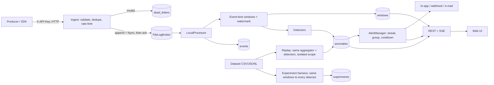

# Architecture

## ADR-001: Stack actually used (and why it differs from the brief)
| Brief | Built | Reason / consequence |
|---|---|---|
| FastAPI + Pydantic | **Flask 3.1** + hand-written validation (`contracts.py`) | FastAPI/Pydantic not installable offline; Flask was present. Validation is explicit and unit-tested. |
| React/TS/Vite/Tailwind/ECharts | **Vanilla JS SPA, no build**, custom SVG charts, served by the API | No npm registry access. UI is not type-checked, has no component unit tests, and was **not exercised in a browser** (JS syntax-checked with `node --check`; every endpoint it calls is covered by API tests). |
| PostgreSQL/Timescale, Alembic | **SQLite (WAL)** with versioned SQL migrations | Portable SQL; see "Scaling path". |
| Redpanda/Kafka | **`FileLogBroker`** (segmented JSONL, fsync) behind a `Broker` interface | Real durability + offsets locally. Kafka adapter **not implemented**. |
| Spark Structured Streaming | **`LocalProcessor`** behind `StreamProcessor` | Single thread; **no distributed mode exists**. UI and API label the mode `local`, `distributed: false`. |
| Redis, Parquet, S3 | not built | Dedupe/state are in-process; CSV and JSONL import work, Parquet import returns an explicit "pyarrow not installed" error. |
| JWT/OIDC | opaque random bearer tokens, hashed (SHA-256) at rest, 12 h TTL, scrypt passwords | Simple, revocable. |

## Data flow

Historical replay and experiments reuse `WindowAggregator` and the detector classes unchanged, so results are comparable with live behaviour. Replay results are stored with `scope=<replay_id>` and never create live alerts.

## Processing semantics
* **Durability policy:** an ingest response is sent only after `Broker.append` returns. `FileLogBroker(fsync=True)` flushes and `fsync`s the batch first; the ack then carries `durable: true`. With `VEYLSTREAM_FSYNC=0` or a `MemoryBroker`, the ack says `durable: false`. A torn trailing write after a crash is truncated on reopen (tested).
* **Delivery:** at-least-once from the log, idempotent sinks (`INSERT OR IGNORE` by event id; windows and anomalies keyed). Ingest-time dedupe is a bounded LRU (default 200k ids), primed on restart from stored events and the unconsumed log tail.
* **Event time:** windows are aligned to multiples of the slide (tumbling by default, 30 s). `watermark = max(event_time) − allowed_lateness (20 s)`. A window closes when its end ≤ watermark. Events whose windows all closed are **late**: not aggregated, written to dead letters as `late_event`, counted. Out-of-order events within lateness are aggregated correctly (tested).
* **Idle streams:** if no events arrive for ~2 s *and* the stream is live (newest event < 180 s old), the watermark advances from the wall clock so a silent producer yields zero-volume windows instead of nothing. Historical backfill is never advanced this way.
* **Empty windows** are emitted for every scope seen before.
* **Percentiles are exact** (numpy linear interpolation over all values in the window). State per open window is O(events in window); windows are released when closed.
* **Recovery:** the checkpoint stores `(oldest offset still needed by an open window, high-water offset, watermark)`. After a crash the processor re-reads from the oldest needed offset, silently skips events whose windows already closed, rebuilds detector baselines from stored windows, and produces windows identical to an uninterrupted run (test `test_restart_yields_identical_aggregates`).
* **Backpressure:** ingest returns 503 `backpressure` when lag > `max_lag` (200k); per-source token-bucket returns 429 + `Retry-After`; request body (2 MB) and batch (1000) are bounded; SSE subscribers have bounded queues (drop-oldest).

## Detection
`Detector.observe_window(WindowMetrics) -> [Detection]`. `score = deviation ÷ the detector's own threshold` (≥ 1 fires); severity is a documented function of that ratio, **not a probability**. Anomalous points are excluded from rolling baselines (so a sustained incident does not normalise itself) until 30 consecutive exclusions. Zero variance is handled by a variance floor (relative 5 % and per-metric absolute). The ensemble votes (`min_agree`, `weighted_vote`); it never averages raw scores and refuses to combine contradictory directions. Alerting policy (min severity, streak length, cooldown) is separate from detection.

## Data model (SQLite; one migration, `schema_migrations`)
workspaces, users, memberships(role), sessions, sources(key_hash), events, windows, anomalies, alerts, alert_audit, suppressions, dead_letters, dq_rules, dq_findings, destinations, deliveries, notifications, datasets, replay_jobs, experiments, audit_events, checkpoints. `windows.metrics_json` stores one row per (window, scope) rather than a row per metric: fewer rows, queried by time range. Raw events are retained 3 days by default (`retention_days`), derived windows 2× that.

## Scaling path (designed, not built)
Replace `SQLite` with PostgreSQL (partition `events`/`windows` by time) or TimescaleDB; `FileLogBroker` with a Redpanda adapter; `LocalProcessor` with a partitioned consumer group or Spark job producing the same `WindowMetrics`. Per-key state (deduper, detector baselines) would need to be partitioned by entity.
